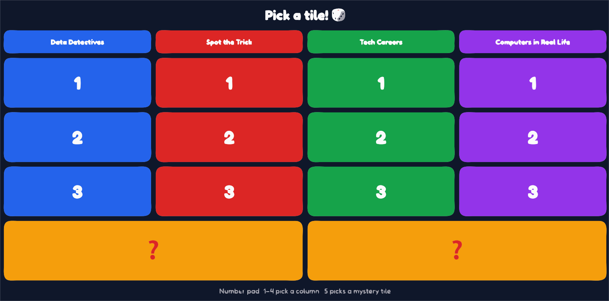
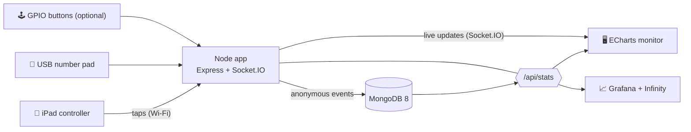

# 🧩 STEM Data Wall

An **offline, kid-friendly interactive data game and live dashboard** for a
Raspberry Pi, built for an elementary-school **STEM Career Day**.

Kids play a Jeopardy-style quiz on an iPad. Their completely **anonymous**
answers instantly become live charts on a big monitor, and the team uses those
charts to spark conversations about careers in **data, solutions architecture,
technical sales, cybersecurity, and automation**.



> 🔒 **No personal data is ever collected** — no names, no typing, no camera,
> no microphone. See [Privacy by design](#-privacy-by-design). The repo is
> public on purpose, so curious kids, parents, and teachers can build their own.

---

## How it works



Everything runs **on the Pi, with no internet**. All JavaScript, CSS, fonts,
emoji, and images are bundled locally; Docker images and the Grafana plugin are
pulled once at setup time and then persist.

### The five screens

| Screen | URL | Who uses it |
| --- | --- | --- |
| **Monitor** | `/` | The crowd-facing big screen. Attract loop when idle; shows the question, a reveal animation, and the live chart during play. |
| **Controller** | `/controller` | The iPad. Jeopardy board → 4 big answer buttons → back to the board. |
| **Results** | `/results` | Live ECharts: answer distribution, category popularity, percent correct, answers over time. |
| **Admin** | `/admin` | PIN-protected: reset the board, reset data, view totals, export CSV. |
| **Staff** | `/staff` | Laptop hub: QR code for the iPad + links to everything, including Grafana. |

---

## Hardware

- **Raspberry Pi 5** with an **SSD** (current MongoDB needs a Pi 5 — Pi 4 CPUs
  are not supported).
- Official **27 W USB-C power supply**.
- **micro-HDMI → HDMI** cable.
- **Portable monitor** (1080p) for the crowd-facing kiosk.
- **Portable travel router** (no internet needed) to make a little private
  Wi-Fi/Ethernet network.
- **Ethernet cable** (Pi → router).
- **iPad or any tablet** on the router's Wi-Fi (the primary input).
- **Laptop** on the Wi-Fi (Ansible control node + Grafana/admin view + backup host).
- *Optional:* **USB number pad** (keys 1–5 as a backup input).
- *Optional:* **4 arcade buttons** + jumper wires to the Pi's GPIO.

---

## Quick start

### Option A — with Ansible (the Raspberry Pi)

From your laptop (on the same network as the Pi):

```bash
cd ansible
cp inventory.example.ini inventory.ini   # edit the Pi's host + user
ansible-galaxy --version                  # ensure Ansible is installed
ansible-playbook -i inventory.ini site.yml
```

To run it **on the Pi itself** instead (no SSH):

```bash
sudo ansible-playbook -i localhost, -c local ansible/site.yml
```

Enable the optional GPIO buttons with `-e buttons_enabled=true`.

When it finishes it **prints the exact URLs and the admin PIN**. The Pi keeps
its existing hostname, so the addresses look like
**http://&lt;your-pi-hostname&gt;.local:8080/** on the monitor and
**http://&lt;your-pi-hostname&gt;.local:8080/staff** on the laptop (for a Pi
named `ubuntu-server-5`, that's `http://ubuntu-server-5.local:8080/`). If mDNS
names don't resolve on your network, pass `-e datawall_host=<the Pi's IP>`.

### Option B — with Docker only (a laptop)

No Ansible needed — works on amd64 or arm64:

```bash
cp .env.example .env     # then edit the passwords + PIN
make up                  # build + start app, MongoDB, and Grafana
make seed-demo           # (optional) add fake data to see the charts
```

| Screen | URL |
| --- | --- |
| Monitor | <http://localhost:8080/> |
| Controller | <http://localhost:8080/controller> |
| Results | <http://localhost:8080/results> |
| Admin | <http://localhost:8080/admin> |
| Staff | <http://localhost:8080/staff> |
| Grafana | <http://localhost:3000/> |

`make help` lists every shortcut. `make down` stops it (keeps data); `make nuke`
removes everything (asks first).

---

## Editing the game (no code changes)

Everything kids see lives in two plain-text files you can edit with any editor:

- **[`content/questions.yaml`](content/questions.yaml)** — 4 categories × 3
  questions. Each question has the text, 4 answers (emoji, label, color), the
  correct answer, and a fun fact. Reading level is aimed at 2nd–4th grade.
- **[`content/team.yaml`](content/team.yaml)** — the 4 team members shown on the
  attract-mode "meet the team" slide (name, company, role, years, fun fact, photo).

Team photos go in `media/team/` (git-ignored, so real photos never get
committed — placeholders ship in the repo). Drop images or `.mp4` videos into
`media/attract/` and they join the attract loop. The app re-reads content when
the board reloads, so you can tweak questions between groups.

---

## Locking a tablet for kiosk use

**iPad (recommended):**

1. On the Pi's `/staff` page, scan the QR code with the iPad camera to open the
   controller.
2. **Add to Home Screen:** Share → *Add to Home Screen*. Opening it from the
   Home Screen hides Safari's bars and runs full screen.
3. **Guided Access** locks it to that one app:
   Settings → Accessibility → Guided Access → On (set a passcode). Open the app,
   then **triple-click the side button** to start Guided Access. Triple-click
   again + passcode to exit.

**Android tablet:** enable **Screen pinning** (Settings → Security → Screen
pinning), open the controller in Chrome (optionally *Add to Home screen*), then
pin it from the recent-apps view.

---

## Optional: GPIO arcade buttons

Disabled by default. Enable with `-e buttons_enabled=true` when running
`site.yml`. Four buttons act like number-pad keys **1–4** (board columns / answers
A–D). They are **active-low with the Pi's internal pull-ups**: each button
connects its GPIO pin to **GND**, and pressing pulls the pin LOW.

Default pins (BCM numbering, configurable via `buttons_pins`):

| Button | Meaning | GPIO (BCM) | Physical pin |
| --- | --- | --- | --- |
| 1 | Column 1 / Answer A | GPIO17 | 11 |
| 2 | Column 2 / Answer B | GPIO27 | 13 |
| 3 | Column 3 / Answer C | GPIO22 | 15 |
| 4 | Column 4 / Answer D | GPIO23 | 16 |
| — | Ground (shared) | GND | 9 / 14 / 20 / 25 |

```
  Button 1          Raspberry Pi GPIO header
  ┌───────┐
  │   o   │──────────────► GPIO17 (pin 11)
  │   o   │──────┐
  └───────┘      └────────► GND  (pin 9)
   (repeat for buttons 2–4 on GPIO27/22/23, sharing any GND pin)
```

The service (`gpio/buttons.py`, run under systemd by the `buttons` role) uses
`gpiozero` with the **lgpio** backend (the Pi 5-compatible one) and POSTs each
press to the app on `localhost`.

---

## 🔒 Privacy by design

This project is built so it **cannot** collect personal information about
children — that's enforced in the code, not just promised:

- **No names, no free text.** There is no text input anywhere. Kids only tap
  pre-written tiles and answers.
- **No camera, no microphone, no device identifiers, no IP addresses** are ever
  read or stored.
- **The database only accepts allowed fields.** The `events` collection has a
  MongoDB `$jsonSchema` validator with `additionalProperties: false`, so a
  record can *only* contain: `type`, `category`, `questionId`, `answerId`,
  `correct`, `station`, and a server timestamp. If anything tried to store a
  `name` (or any other field), MongoDB would **reject** it.
- **Mystery tiles store only the chosen topic** (e.g. "money"), never anything
  anyone says.
- **The database isn't on the network.** MongoDB's port is bound to `127.0.0.1`
  only, so it's never reachable from the open Wi-Fi.
- **Team photos stay private.** `media/team/` is git-ignored; only placeholders
  are committed.

A single event looks like this — there is nothing personal to find:

```json
{ "type": "answer", "category": "data_detectives", "questionId": "dd1",
  "answerId": "a", "correct": true, "station": "table-1",
  "ts": "2026-11-10T15:04:05.000Z" }
```

---

## How this connects to real tech careers

The wall is a tiny, honest version of a real data system — a great way to show
kids (and parents) what these jobs actually do:

- **Data engineering** — events flow from the game into a database, then get
  aggregated into stats. That pipeline (collect → store → summarize) is the core
  of data work.
- **Solutions architecture** — the pieces (app, database, dashboards, kiosk) are
  designed to fit together cleanly, run offline, and be easy to set up. That's
  what a solutions architect plans.
- **Technical sales engineering** — the whole point is a *live demo* that turns
  data into a story people care about. Technical sales engineers do exactly this:
  show how technology solves a real problem.
- **Cybersecurity** — privacy-by-design, least-privilege database users, and
  binding the database to localhost are everyday security practices. The "Spot
  the Trick" category teaches the kid version.
- **Automation engineering** — one `ansible-playbook` command turns a blank Pi
  into the whole kiosk, and tears it back down. That's infrastructure as code.

---

## Before and after an event

The Pi has no internet at the event, but background OS updates can still wake up,
grab the apt lock, or restart a service at the worst moment. **Event mode** turns
those off for the day (it stops and disables `unattended-upgrades` and the
`apt-daily` / `apt-daily-upgrade` timers).

Just before the event — quiet all background updates:

```bash
cd ansible
ansible-playbook -i inventory.ini event-mode.yml -e event_mode=true
```

Afterward — let the Pi update itself normally again:

```bash
ansible-playbook -i inventory.ini event-mode.yml -e event_mode=false
```

You can also bake it into a full provision with
`ansible-playbook -i inventory.ini site.yml -e event_mode=true`. Running
`teardown.yml` always re-enables background updates.

> **A note on the hostname:** this project **never changes the Pi's hostname.**
> It reaches the Pi at `<your-pi-hostname>.local` (published over mDNS by avahi),
> and the kiosk URL, Grafana link, and `/staff` QR code all follow from that. If
> that name doesn't resolve, provision with `-e datawall_host=<the Pi's IP>` and
> everything uses the IP instead.

---

## Resetting and tearing down

| Tool | What it does |
| --- | --- |
| `make seed-demo` / `scripts/seed_demo.py` | Insert realistic fake events to demo the charts |
| `make reset-events` / `reset_db.py --events` | Delete all events; keep collection, schema, indexes |
| `make reset-board` / `reset_db.py --board` | Reset only the game board (used tiles); keep events |
| `make reset-all` / `reset_db.py --all` | Drop the DB; recreate collection + schema + indexes |
| `make backup-data` / `reset_db.py --backup PATH` | Export events to timestamped JSON (no deletion) |
| `ansible/reset-data.yml` | Run a reset on the Pi from the laptop (`-e mode=events\|board\|all`) |
| `ansible/teardown.yml` | Remove everything `site.yml` created (needs `-e confirm_teardown=yes`) |
| `make nuke` | Docker-only teardown: `compose down -v --rmi local` + remove `.env` |

After a reset, the running app clears the monitor, results page, and iPad
**live** (no reload); Grafana clears on its next refresh. See
[`scripts/README.md`](scripts/README.md) for running resets from a laptop over
an SSH tunnel.

### Full round-trip (provision → use → reset → teardown → rebuild)

```bash
# 1. Provision a blank Pi
ansible-playbook -i inventory.ini site.yml

# 2. Try it with demo data, then clear it
ansible-playbook -i inventory.ini reset-data.yml -e mode=all -e confirm_reset=yes

# 3. Tear it all down (backs up to the laptop first)
ansible-playbook -i inventory.ini teardown.yml -e confirm_teardown=yes

# 4. Rebuild from scratch — the Pi works again
ansible-playbook -i inventory.ini site.yml
```

---

## Troubleshooting

- **`<your-pi-hostname>.local` won't resolve?** Use the Pi's IP address instead
  (the `/staff` page shows the addresses), or check that `avahi-daemon` is
  running. You can also provision with `-e datawall_host=<the Pi's IP>` so every
  link and the QR code use the IP.
- **Charts empty?** Run `make seed-demo` to add demo data, or play a round.
- **iPad shows "Reconnecting…"?** It lost Wi-Fi to the Pi; it recovers
  automatically when the network returns.
- **Grafana panel empty?** Confirm the Infinity plugin is installed and that
  Grafana can reach the app at `http://app:3000` (same Docker network).

---

## Project layout

```
server/        Node app (Express + Socket.IO), game logic, stats, DB setup
public/        The five screens + vendored ECharts/font/QR (offline)
content/       questions.yaml + team.yaml (edit these!)
db/            events.schema.json + indexes.json (one source of truth)
scripts/       reset_db.py + seed_demo.py (Python)
grafana/       Infinity datasource + dashboard provisioning
gpio/          optional arcade-button service
ansible/       site.yml, reset-data.yml, teardown.yml, roles/
```

## License

[MIT](LICENSE)
