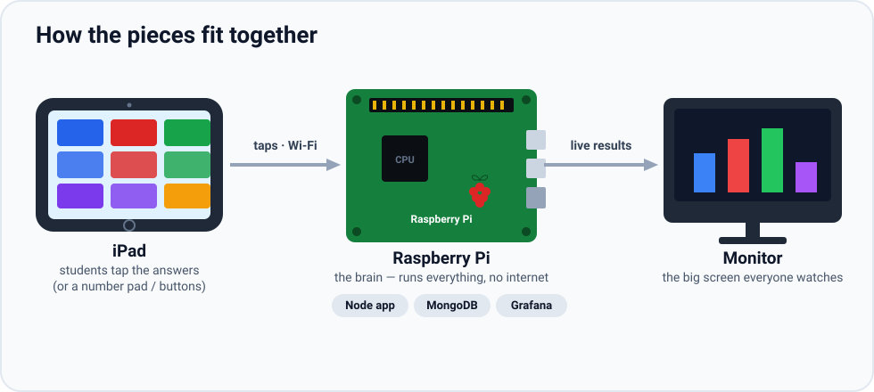
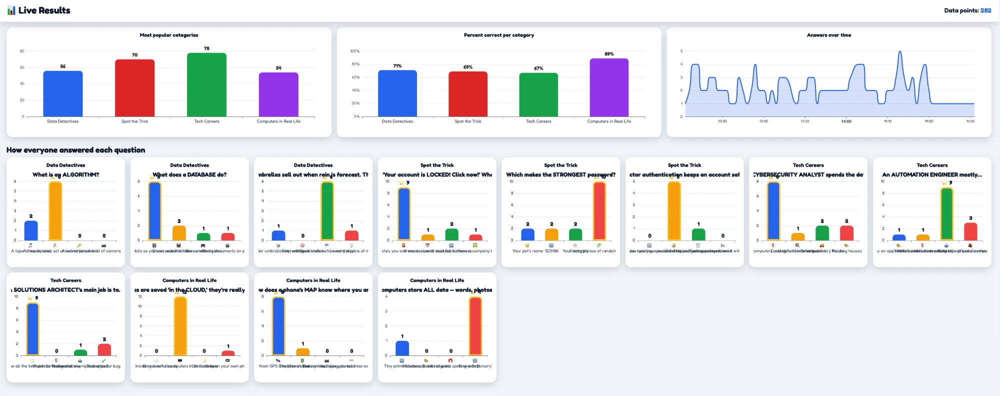
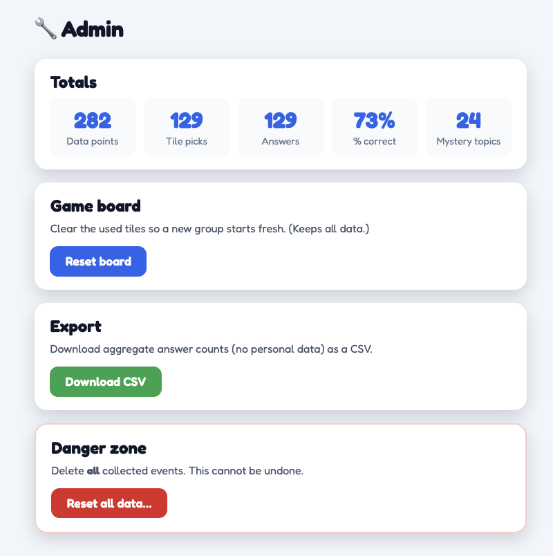
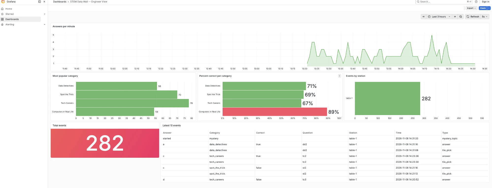
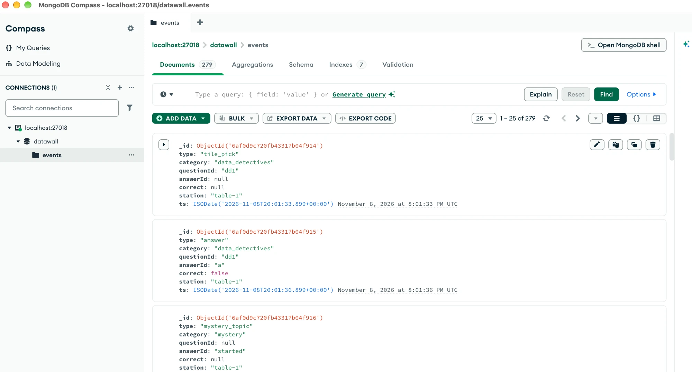

# 🧩 STEM Data Wall

An **offline, kid-friendly interactive data game and live dashboard** for a
Raspberry Pi, built for a school **STEM Career Day** (grades 3–8, about
ages 8–14).

Kids play a Jeopardy-style quiz on an iPad. Their completely **anonymous**
answers instantly become live charts on a big monitor, and the team uses those
charts to spark conversations about careers in **data, solutions architecture,
technical sales, cybersecurity, and automation**.


> 🔒 **No personal data is ever collected** — no names, no typing, no camera,
> no microphone. See [Privacy by design](#-privacy-by-design). The repo is
> public on purpose, so curious kids, parents, and teachers can build their own.

---

## How it works



**The pieces:** kids tap answers on the **iPad** (or a USB number pad / arcade
buttons). Those taps travel over the Pi's own Wi-Fi to the **Raspberry Pi**,
which runs everything with no internet — the Node app (Express + Socket.IO), the
**MongoDB** database that stores one tiny anonymous event per tap, and
**Grafana**. The app pushes **live results** to the big **monitor** (ECharts)
the instant each answer comes in, and the same data feeds the `/results` page
and the Grafana engineer dashboard.

Everything runs **on the Pi, with no internet**. All JavaScript, CSS, fonts,
emoji, and images are bundled locally; Docker images and the Grafana plugin are
pulled once at setup time and then persist. The Grafana engineer view pins
**grafana-oss `12.4.3`** and the **Infinity plugin `4.1.6`** together — a
compatible pair (Infinity 4.1.6 needs Grafana ≥ 12.2.5). Bump both together in
[`ansible/group_vars/all.yml`](ansible/group_vars/all.yml) and `.env.example`,
never using `latest`.

### The five screens

| Screen | URL | Who uses it |
| --- | --- | --- |
| **Monitor** | `/` | The crowd-facing big screen. Attract loop when idle; shows the question, a reveal animation, and the live chart during play. |
| **Controller** | `/controller` | The iPad. Jeopardy board (tiles show **100/200/300** by difficulty, plus two **AMA** tiles) → 4 big answer buttons → back to the board. |
| **Results** | `/results` | Live ECharts: answer distribution, category popularity, percent correct, answers over time. |
| **Admin** | `/admin` | PIN-protected: reset the board, reset data, view totals, export CSV. |
| **Staff** | `/staff` | Laptop hub: QR code for the iPad + links to everything, including Grafana. |

Here's what the data-facing screens look like with demo data loaded.

**Results (`/results`)** — the crowd-facing results page. Every tap on the iPad
streams in over Socket.IO and these ECharts redraw live: most-popular category,
percent correct, answers over time, and a per-question breakdown of how everyone
answered (the ⭐ marks the correct choice). It turns the room's own answers into
an instant, no-personal-data visualization kids can see themselves in.



**Admin (`/admin`)** — the PIN-protected control panel. At a glance: total data
points, tile picks, answers, percent correct, and mystery/AMA topics. From here
staff **reset the board** for the next group (keeps the data), **export the
aggregate counts to CSV** (no personal data), or wipe everything in the danger
zone. This is how you interact with and manage what's been collected during an
event.



### The engineer dashboard (Grafana)

The same anonymous events feed a **Grafana** dashboard (the *Engineer View*),
reachable from the staff hub. It's the grown-up, real-world counterpart to the
kid-facing results page: answers-per-minute trend, most-popular and
percent-correct-per-category panels, events-by-station, a big total-events stat,
and a live table of the latest events. Showing it next to the playful monitor is
a great way to make the point that **the colorful game and a professional
analytics dashboard are reading the exact same data** — which is what real data
engineers do.



---

## Hardware

- **Raspberry Pi 5** with an **SSD** (current MongoDB needs a Pi 5 — Pi 4 CPUs
  are not supported).
- Official **27 W USB-C power supply**.
- **micro-HDMI → HDMI** cable.
- **Portable monitor** (1080p) for the crowd-facing kiosk.
- **Portable travel router** (no internet needed) to make a little private
  Wi-Fi/Ethernet network.
- **Ethernet cable** (Pi → router).
- **iPad or any tablet** on the router's Wi-Fi (the primary input).
- **Laptop** on the Wi-Fi (Ansible control node + Grafana/admin view + backup host).
- *Optional:* **USB number pad** (keys 1–5 as a backup input).
- *Optional:* **4 arcade buttons** + jumper wires to the Pi's GPIO.

---

## Quick start

### Option A — with Ansible (the Raspberry Pi)

From your laptop (on the same network as the Pi):

```bash
cd ansible
cp inventory.example.ini inventory.ini   # edit the Pi's host + user
ansible-galaxy collection install -r requirements.yml  # installs community.general
ansible-playbook -i inventory.ini site.yml
```

> You need **ansible-core ≥ 2.17** (`pip install "ansible-core>=2.17"`) for the
> `ansible.builtin.systemd_service` module. `requirements.yml` lists the
> `community.general` collection (pinned `>=8.0.0`); `ansible.cfg` sets
> `collections_path = collections`, so the install step above drops it into
> `ansible/collections/` (git-ignored) rather than a shared system path.

To run it **on the Pi itself** instead (no SSH):

```bash
sudo ansible-playbook -i localhost, -c local ansible/site.yml
```

Enable the optional GPIO buttons with `-e buttons_enabled=true`.

To **stand it up already full of demo data** (so the charts and Grafana show
something on first boot), add `-e seed_demo=true`:

```bash
ansible-playbook -i inventory.ini site.yml -e seed_demo=true
```

Seeding is guarded so re-running `site.yml` never piles on more data — it seeds
once on a fresh database, then does nothing. To add more data later, or to
reseed after clearing it, use `seed-data.yml` (below).

When it finishes it **prints the exact URLs and the admin PIN**. The Pi keeps
its existing hostname, so the addresses look like
**http://&lt;your-pi-hostname&gt;.local:8080/** on the monitor and
**http://&lt;your-pi-hostname&gt;.local:8080/staff** on the laptop (for a Pi
named `ubuntu-server-5`, that's `http://ubuntu-server-5.local:8080/`). If mDNS
names don't resolve on your network, pass `-e datawall_host=<the Pi's IP>`.

### Option B — with Docker only (a laptop)

No Ansible needed — works on amd64 or arm64:

```bash
cp .env.example .env     # then edit the passwords + PIN
make up                  # build + start app, MongoDB, and Grafana
make seed-demo           # (optional) add fake data to see the charts
```

| Screen | URL |
| --- | --- |
| Monitor | <http://localhost:8080/> |
| Controller | <http://localhost:8080/controller> |
| Results | <http://localhost:8080/results> |
| Admin | <http://localhost:8080/admin> |
| Staff | <http://localhost:8080/staff> |
| Grafana | <http://localhost:3000/> |

`make help` lists every shortcut. `make down` stops it (keeps data); `make nuke`
removes everything (asks first).

---

## Finding your credentials on the Pi

Ansible installs the project on the Pi at **`/opt/stem-data-wall`** — the
`install_dir` variable in
[`ansible/group_vars/all.yml`](ansible/group_vars/all.yml), which you can
override with `-e install_dir=/your/path`. On the first provision it generates
the Pi's **`/opt/stem-data-wall/.env`** with its own **random admin PIN** and
**random MongoDB passwords**.

> ⚠️ **This is not the same `.env` as a local dev checkout.** A laptop or dev
> server running `docker compose` (Option B above) has its *own* `.env` with
> *different* values. When you connect to the **Pi**, always read the **Pi's**
> copy — a PIN or password from your laptop's `.env` will not work against the Pi.

Read the Pi's credentials from your laptop over SSH:

```bash
ssh <user>@<pi-host> 'sudo grep -E "ADMIN_PIN|MONGO_ROOT|MONGO_APP" /opt/stem-data-wall/.env'
```

If the stack was installed somewhere else, ask Docker where its folder is:

```bash
docker inspect datawall-app --format '{{ index .Config.Labels "com.docker.compose.project.working_dir" }}'
```

What each value is for:

| Variable | What it is |
| --- | --- |
| `ADMIN_PIN` | Unlocks the `/admin` page (reset board/data, totals, CSV export). |
| `MONGO_ROOT_USERNAME` / `MONGO_ROOT_PASSWORD` | Full MongoDB admin. Authenticates against the **`admin`** database. Use this for Compass. |
| `MONGO_APP_USERNAME` / `MONGO_APP_PASSWORD` | The least-privilege user the app and scripts use. Authenticates against **`MONGO_DB`** (the `datawall` database). |
| `MONGO_URI` | The app's connection string. It uses the Docker **service name `mongo`**, which only resolves **inside** the Docker network — not from your laptop. |

> **Changed `.env` and now authentication fails?** MongoDB creates the root and
> app users **only the first time its data volume initializes.** Editing the
> passwords in `.env` afterward does **not** update the database, so auth fails
> until you reset the data — `scripts/reset_db.py --all` (or
> `ansible-playbook reset-data.yml -e mode=all -e confirm_reset=yes`) — or tear
> the stack down and rebuild it.

---

## Exploring the data with MongoDB Compass

All the data lives in a single **MongoDB** collection — `datawall.events` — one
document per tap. Each document is deliberately tiny and anonymous: the event
type, the category/question/answer, whether it was correct, which station, and a
timestamp — and nothing else (the `$jsonSchema` validator rejects any stray
field). This is where every chart, the admin totals, and the Grafana dashboard
ultimately read from.



MongoDB's port is bound to **`127.0.0.1` on the Pi on purpose** (see
[Privacy by design](#-privacy-by-design)), so it is never reachable from the
open Wi-Fi. To browse the data with
[MongoDB Compass](https://www.mongodb.com/products/compass), connect through an
**SSH tunnel**.

**Recommended — a terminal tunnel.** In one terminal, forward a local port to
the Pi's MongoDB and leave it running:

```bash
ssh -N -L 27018:127.0.0.1:27017 -i <your-key> <user>@<pi-host>
```

Then in Compass, connect with:

- **Host:** `localhost:27018`
- **Authentication:** Username / Password — the **`MONGO_ROOT_USERNAME`** and
  **`MONGO_ROOT_PASSWORD`** from the **Pi's** `.env`
- **Authentication Database:** `admin`
- **Proxy/SSH:** None   •   **TLS/SSL:** Off

Using local port **27018** (not 27017) avoids clashing with a MongoDB already
running on your laptop.

**Alternative — let Compass make the tunnel.** Use Compass's built-in
**"SSH with Identity File"** option (Mongo host `127.0.0.1:27017`, plus your Pi
user and key) instead of the terminal command.

**Troubleshooting Compass:**

- **macOS `EHOSTUNREACH` even though `ssh` works.** Compass's **Local Network**
  privacy permission can go stale after an app update. Toggle *MongoDB Compass*
  off and on in **System Settings → Privacy & Security → Local Network** and
  restart Compass — or just use the terminal tunnel above, which avoids the
  issue entirely.
- **"Authentication failed."** Usually the credentials came from the **wrong
  `.env`** (a laptop's instead of the Pi's), or the **Authentication Database**
  is wrong (root user → `admin`, app user → `datawall`).

> 💡 **For teachers:** open the `events` collection's **Validation** tab in
> Compass to *show* the `$jsonSchema` that makes storing personal data
> impossible — a live demonstration of privacy by design. Treat Compass as
> **read-only** during an event.

---

## Editing the game (no code changes)

Everything kids see lives in two plain-text files you can edit with any editor:

- **[`content/questions.yaml`](content/questions.yaml)** — 4 categories × 3
  questions. Each question has the text, 4 answers (emoji, label, color), the
  correct answer, and a fun fact. Questions are aimed at **grades 3–8**, and
  within each category the three tiles ramp in difficulty — shown on the board
  as **100 / 200 / 300** points (easy → challenging). Points are just labels:
  there is **no scoring, leaderboard, or prizes**. The two **AMA** ("Ask Us
  Anything") tiles let the team field questions about their jobs out loud; only
  the chosen topic is ever stored.
- **[`content/team.yaml`](content/team.yaml)** — the 4 team members shown on the
  attract-mode "meet the team" slide (name, company, role, years, fun fact, photo).

Team photos go in `media/team/` (git-ignored, so real photos never get
committed — placeholders ship in the repo). Drop images or `.mp4` videos into
`media/attract/` and they join the attract loop. The app re-reads content when
the board reloads, so you can tweak questions between groups.

---

## Locking a tablet for kiosk use

**iPad (recommended):**

1. On the Pi's `/staff` page, scan the QR code with the iPad camera to open the
   controller.
2. **Add to Home Screen:** Share → *Add to Home Screen*. Opening it from the
   Home Screen hides Safari's bars and runs full screen.
3. **Guided Access** locks it to that one app:
   Settings → Accessibility → Guided Access → On (set a passcode). Open the app,
   then **triple-click the side button** to start Guided Access. Triple-click
   again + passcode to exit.

**Android tablet:** enable **Screen pinning** (Settings → Security → Screen
pinning), open the controller in Chrome (optionally *Add to Home screen*), then
pin it from the recent-apps view.

---

## Optional: GPIO arcade buttons

Disabled by default. Enable with `-e buttons_enabled=true` when running
`site.yml`. Four buttons act like number-pad keys **1–4** (board columns / answers
A–D). They are **active-low with the Pi's internal pull-ups**: each button
connects its GPIO pin to **GND**, and pressing pulls the pin LOW.

Default pins (BCM numbering, configurable via `buttons_pins`):

| Button | Meaning | GPIO (BCM) | Physical pin |
| --- | --- | --- | --- |
| 1 | Column 1 / Answer A | GPIO17 | 11 |
| 2 | Column 2 / Answer B | GPIO27 | 13 |
| 3 | Column 3 / Answer C | GPIO22 | 15 |
| 4 | Column 4 / Answer D | GPIO23 | 16 |
| — | Ground (shared) | GND | 9 / 14 / 20 / 25 |

```
  Button 1          Raspberry Pi GPIO header
  ┌───────┐
  │   o   │──────────────► GPIO17 (pin 11)
  │   o   │──────┐
  └───────┘      └────────► GND  (pin 9)
   (repeat for buttons 2–4 on GPIO27/22/23, sharing any GND pin)
```

The service (`gpio/buttons.py`, run under systemd by the `buttons` role) uses
`gpiozero` with the **lgpio** backend (the Pi 5-compatible one) and POSTs each
press to the app on `localhost`.

---

## 🔒 Privacy by design

This project is built so it **cannot** collect personal information about
children — that's enforced in the code, not just promised:

- **No names, no free text.** There is no text input anywhere. Kids only tap
  pre-written tiles and answers.
- **No camera, no microphone, no device identifiers, no IP addresses** are ever
  read or stored.
- **The database only accepts allowed fields.** The `events` collection has a
  MongoDB `$jsonSchema` validator with `additionalProperties: false`, so a
  record can *only* contain: `type`, `category`, `questionId`, `answerId`,
  `correct`, `station`, and a server timestamp. If anything tried to store a
  `name` (or any other field), MongoDB would **reject** it.
- **Mystery tiles store only the chosen topic** (e.g. "money"), never anything
  anyone says.
- **The database isn't on the network.** MongoDB's port is bound to `127.0.0.1`
  only, so it's never reachable from the open Wi-Fi.
- **Team photos stay private.** `media/team/` is git-ignored; only placeholders
  are committed.

A single event looks like this — there is nothing personal to find:

```json
{ "type": "answer", "category": "data_detectives", "questionId": "dd1",
  "answerId": "a", "correct": true, "station": "table-1",
  "ts": "2026-11-10T15:04:05.000Z" }
```

---

## How this connects to real tech careers

The wall is a tiny, honest version of a real data system — a great way to show
kids (and parents) what these jobs actually do:

- **Data engineering** — events flow from the game into a database, then get
  aggregated into stats. That pipeline (collect → store → summarize) is the core
  of data work.
- **Solutions architecture** — the pieces (app, database, dashboards, kiosk) are
  designed to fit together cleanly, run offline, and be easy to set up. That's
  what a solutions architect plans.
- **Technical sales engineering** — the whole point is a *live demo* that turns
  data into a story people care about. Technical sales engineers do exactly this:
  show how technology solves a real problem.
- **Cybersecurity** — privacy-by-design, least-privilege database users, and
  binding the database to localhost are everyday security practices. The "Spot
  the Trick" category teaches the kid version.
- **Automation engineering** — one `ansible-playbook` command turns a blank Pi
  into the whole kiosk, and tears it back down. That's infrastructure as code.

---

## Before and after an event

The Pi has no internet at the event, but background OS updates can still wake up,
grab the apt lock, or restart a service at the worst moment. **Event mode** turns
those off for the day (it stops and disables `unattended-upgrades` and the
`apt-daily` / `apt-daily-upgrade` timers).

Just before the event — quiet all background updates:

```bash
cd ansible
ansible-playbook -i inventory.ini event-mode.yml -e event_mode=true
```

Afterward — let the Pi update itself normally again:

```bash
ansible-playbook -i inventory.ini event-mode.yml -e event_mode=false
```

You can also bake it into a full provision with
`ansible-playbook -i inventory.ini site.yml -e event_mode=true`. Running
`teardown.yml` always re-enables background updates.

> **A note on the hostname:** this project **never changes the Pi's hostname.**
> Other devices reach the Pi at `<your-pi-hostname>.local` (published over mDNS
> by avahi), and the `/staff` links + QR code, the Grafana link, and the printed
> summary all follow from that. If that name doesn't resolve, provision with
> `-e datawall_host=<the Pi's IP>` and those all use the IP instead. The kiosk on
> the Pi's **own** screen always loads `http://localhost:8080/`, so the big
> display never depends on mDNS.

---

## Resetting and tearing down

| Tool | What it does |
| --- | --- |
| `make seed-demo` / `scripts/seed_demo.py` | Insert realistic fake events to demo the charts (on this machine) |
| `ansible/seed-data.yml` | Seed/reseed the Pi from the laptop; **additive** — run again for more data |
| `make reset-events` / `reset_db.py --events` | Delete all events; keep collection, schema, indexes |
| `make reset-board` / `reset_db.py --board` | Reset only the game board (used tiles); keep events |
| `make reset-all` / `reset_db.py --all` | Drop the DB; recreate collection + schema + indexes |
| `make backup-data` / `reset_db.py --backup PATH` | Export events to timestamped JSON (no deletion) |
| `ansible/reset-data.yml` | Run a reset on the Pi from the laptop (`-e mode=events\|board\|all`) |
| `ansible/teardown.yml` | Remove what `site.yml` created (needs `-e confirm_teardown=yes`); see [Tearing down the Pi](#tearing-down-the-pi) for the full cleanup |
| `make nuke` | Docker-only teardown: `compose down -v --rmi local` + remove `.env` |

After a reset, the running app clears the monitor, results page, and iPad
**live** (no reload); Grafana clears on its next refresh. See
[`scripts/README.md`](scripts/README.md) for running resets from a laptop over
an SSH tunnel.

### Seeding demo data from your laptop

`ansible/seed-data.yml` runs the seeder **on the Pi**. Every run *adds* more
events (it never deletes), so after `reset-data.yml` you can seed again for a
fresh batch:

```bash
ansible-playbook -i inventory.ini seed-data.yml                   # ~150 plays, last 60 min
ansible-playbook -i inventory.ini seed-data.yml -e count=400 -e minutes=180
ansible-playbook -i inventory.ini seed-data.yml -e 'stations="table-1 table-2"'
ansible-playbook -i inventory.ini seed-data.yml -e if_empty=true  # only if the DB is empty
```

Tunables (all optional, override with `-e`): `count`, `minutes`, `correct_rate`,
`mystery_rate`, `stations`, `if_empty`. The charts update live after seeding.

### Tearing down the Pi

`ansible/teardown.yml` refuses to run without `-e confirm_teardown=yes`. By
default it backs up events to your laptop first, then removes **what `site.yml`
created at the app level**: it stops the stack and deletes its Docker volumes
(so the MongoDB data is gone), removes the built app image and the project
directory in `install_dir` (code, `.env`, provisioning, backups), removes the
kiosk autologin, the `kiosk` user, and the GPIO buttons service, and re-enables
the background apt updates. It deliberately **leaves the base system alone** —
Docker Engine, the cage + Chromium packages, and avahi all stay installed:

```bash
# Default teardown: remove the app + kiosk + data volumes, keep the base system
ansible-playbook -i inventory.ini teardown.yml -e confirm_teardown=yes
```

For a **full cleanup** — returning the machine close to its pre-provision state
— add the three purge flags. On top of the default teardown this also removes
cage + Chromium, uninstalls Docker Engine, and stops/disables avahi and removes
the state directory:

```bash
# Full cleanup: also purge kiosk packages, Docker, and revert system changes
ansible-playbook -i inventory.ini teardown.yml -e confirm_teardown=yes \
  -e teardown_purge_kiosk_packages=true \
  -e teardown_purge_docker=true \
  -e teardown_revert_system=true
```

| Flag (pass with `-e`) | Default | Effect when `true` |
| --- | --- | --- |
| `confirm_teardown=yes` | *required* | Without it, the playbook refuses to run |
| `teardown_backup` | `true` | Export events to a JSON backup and fetch it to `./backups/` first; set `false` to skip |
| `teardown_purge_kiosk_packages` | `false` | Also uninstall cage + Chromium |
| `teardown_purge_docker` | `false` | Also uninstall Docker Engine (packages, apt repo, GPG key) |
| `teardown_revert_system` | `false` | Also stop/disable avahi and remove the state directory (the avahi package stays installed) |

You can also target one layer with tags, e.g.
`teardown.yml -e confirm_teardown=yes --tags kiosk`.

### Full round-trip (provision → use → reset → teardown → rebuild)

```bash
# 1. Provision a blank Pi
ansible-playbook -i inventory.ini site.yml

# 2. Fill it with demo data, look at the charts, then clear it
ansible-playbook -i inventory.ini seed-data.yml
ansible-playbook -i inventory.ini reset-data.yml -e mode=all -e confirm_reset=yes

#    …and seed again for a fresh batch whenever you like (additive)
ansible-playbook -i inventory.ini seed-data.yml -e count=300

# 3. Tear it all down (backs up to the laptop first). Add the purge flags for a
#    full cleanup that also removes Docker, the kiosk packages, and avahi.
ansible-playbook -i inventory.ini teardown.yml -e confirm_teardown=yes \
  -e teardown_purge_kiosk_packages=true \
  -e teardown_purge_docker=true \
  -e teardown_revert_system=true

# 4. Rebuild from scratch — the Pi works again
ansible-playbook -i inventory.ini site.yml
```

---

## Troubleshooting

- **`<your-pi-hostname>.local` won't resolve?** Use the Pi's IP address instead
  (the `/staff` page shows the addresses), or check that `avahi-daemon` is
  running. You can also provision with `-e datawall_host=<the Pi's IP>` so every
  link and the QR code use the IP.
- **Charts empty?** Run `make seed-demo` to add demo data, or play a round.
- **iPad shows "Reconnecting…"?** It lost Wi-Fi to the Pi; it recovers
  automatically when the network returns.
- **Grafana panel empty?** Confirm the Infinity plugin is installed and that
  Grafana can reach the app at `http://app:3000` (same Docker network).
- **Grafana panels show a plugin error** (e.g. *"…failed. Error: 404 Not Found,
  loading react/jsx-runtime from …/yesoreyeram-infinity-datasource/module.js"*)?
  The installed Infinity plugin version doesn't match the Grafana version. The
  repo pins a compatible pair (grafana-oss `12.4.3` + Infinity `4.1.6`); **re-run
  `site.yml`** — it upgrades Grafana and installs the pinned plugin version
  (replacing a mismatched one), then restarts Grafana. For a Docker-only setup,
  `make down && make up` picks up the pinned versions (or `make nuke` to rebuild
  from a clean volume).
- **`permission denied while trying to connect to the Docker API`?** The
  playbook adds your login user to the `docker` group, but group membership only
  takes effect in a **new login session**. Log out and back in, close any
  multiplexed SSH connection with `ssh -O exit <user>@<pi-host>`, or just use
  `sudo docker` for now.
- **Running Ansible *on the Pi* instead of the laptop?** A remote run uses the
  laptop's SSH key to reach the Pi; on the Pi there is no such hop, so use
  `-c local` (e.g. `ansible-playbook -i localhost, -c local site.yml`).
- **Ad-hoc inventory needs a trailing comma.** When you pass hosts inline, the
  comma is required: `-i 'ubuntu-server-5.local,'` (or `-i localhost,`).

---

## Project layout

```
server/        Node app (Express + Socket.IO), game logic, stats, DB setup
public/        The five screens + vendored ECharts/font/QR (offline)
content/       questions.yaml + team.yaml (edit these!)
db/            events.schema.json + indexes.json (one source of truth)
scripts/       reset_db.py + seed_demo.py (Python)
grafana/       Infinity datasource + dashboard provisioning
gpio/          optional arcade-button service
ansible/       site.yml, seed-data.yml, reset-data.yml, teardown.yml, roles/
```

## License

[MIT](LICENSE)
